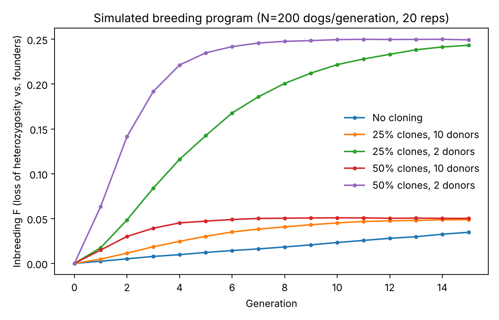

# Working-Dog Breeding-Program Genetics

**Status: in progress**

How does cloning elite working dogs affect the genetic health of a breeding population?

Programs that clone top-performing dogs (Belgian Malinois, German Shepherds) copy proven traits, but they also shrink the gene pool. A smaller gene pool means higher inbreeding, and inbreeding brings a higher risk of inherited disease. This project measures genetic diversity in real working-breed genotype data and simulates how different cloning strategies change inbreeding over generations.

## Questions

1. How much genomic inbreeding is already present in Belgian Malinois, related Belgian shepherd varieties, and German Shepherd Dogs?
2. How clearly do these breeds and varieties separate genetically (population structure)?
3. In a managed breeding program, how do the **share of cloned dogs** and the **number of elite donors** affect inbreeding and effective population size over time?

## Approach

| Step | Method | Status |
|---|---|---|
| Quality control | PLINK: call-rate, minor-allele-frequency filters | Scripted |
| Population structure | LD pruning + PCA | Scripted |
| Genomic inbreeding | Runs of homozygosity (ROH) → F_ROH per dog | Scripted |
| Breeding-program simulation | Forward simulation of a closed population with clones | Working v0 |
| Write-up | 2-page summary of findings and implications | Not started |

## Data

Public SNP-array genotypes (see `data/README.md` for download links):

- **Belgian shepherds:** ~870 dogs (Malinois, Tervuren, Sheepdog) genotyped on canine HD SNP arrays (Dryad, from a gastric cancer GWAS).
- **German Shepherd Dogs:** healthy and affected dogs genotyped on the Illumina CanineHD BeadChip (~220k SNPs) (Zenodo, from a megaesophagus study).

Raw genotype files are not committed to this repo.

## Repo layout

```
data/        download instructions (raw files are gitignored)
scripts/     PLINK pipeline: QC, PCA, ROH
analysis/    Python: PCA plots, F_ROH summaries
sim/         breeding-program simulation
results/     figures and tables
```

## Early simulation result (v0)



In this first version, **the number of banked donors matters far more than the share of dogs that are clones.** With 10 donors, inbreeding after 15 generations stays near 5% whether a quarter or half of each generation is cloned. With only 2 donors, it climbs to about 25%. Banked donors re-enter the gene pool every generation, so the program's long-run diversity converges toward the diversity of the donor bank itself.

Caveats: this model has unlinked loci, random donor choice, no selection, and non-overlapping generations. The next step is to seed the simulation with real allele frequencies from the Malinois and German Shepherd data.

## Running the simulation

```bash
pip install -r requirements.txt
python sim/breeding_sim.py
```

Outputs `results/sim_inbreeding.png` and `results/sim_summary.csv`.
